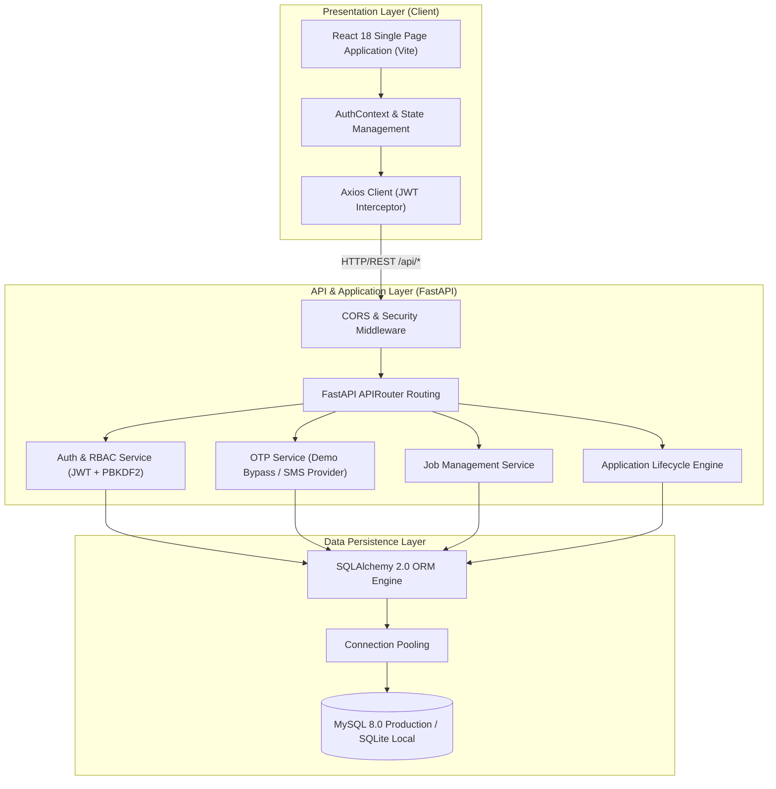
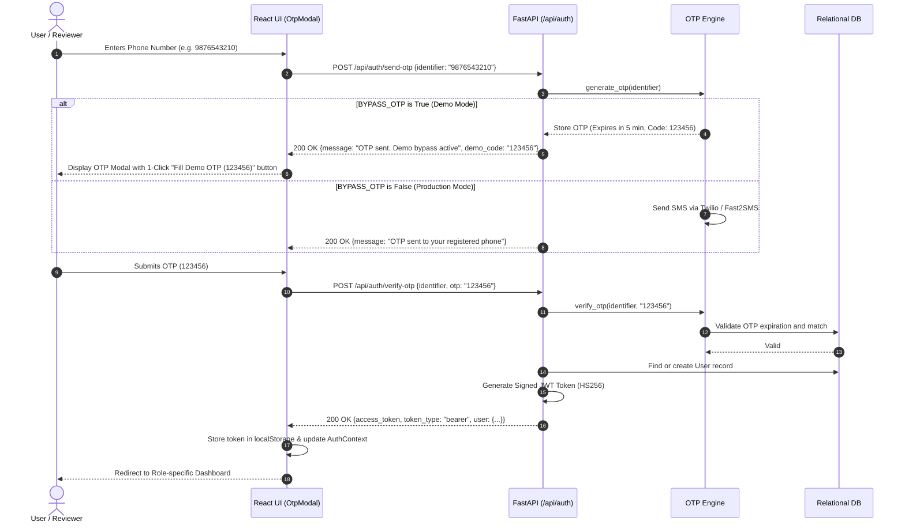
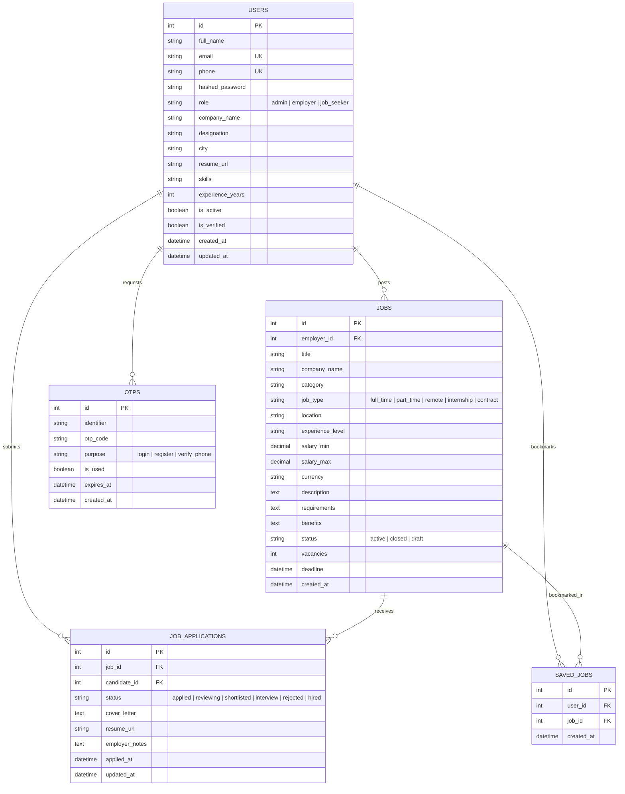

# Job4You Architecture & System Design Documentation

## 1. System Overview

**Job4You** is a modern, high-performance recruitment and job search platform re-engineered from a monolithic PHP/Laravel legacy application into a decoupled, scalable, cloud-native architecture using **FastAPI (Python 3)**, **React 18 (Vite)**, and **MySQL 8.0 / SQLite**.

The platform is designed around clean architecture principles, separating concerns across:
- **Presentation Layer**: Responsive React 18 Single Page Application with dynamic state and role-based views.
- **API Gateway & Business Logic Layer**: High-speed asynchronous Python FastAPI application with Pydantic V2 validation and JWT/RBAC security.
- **Data Persistence Layer**: SQLAlchemy 2.0 ORM with connection pooling, supporting production MySQL and zero-configuration SQLite for development.

---

## 2. Authentication & Demo OTP Bypass Architecture

Job4You supports dual-mode enterprise authentication:
1. **Phone Number + OTP Verification** (Modern, friction-free login for mobile and web).
2. **Email + Secure Password** (Enterprise & administrator authentication).

### Demo OTP Bypass Architecture
For developer evaluation, investor demos, and portfolio review, SMS gateways (like Twilio, AWS SNS, or Fast2SMS) can incur recurring costs or fail due to carrier filtering. Job4You features an intelligent, configurable **Demo OTP Bypass engine**:

- **Configuration Key**: `BYPASS_OTP=True` in `.env`
- **Pre-configured Codes**: Accepts `123456` or `1111` for any mobile number.
- **Frontend Integration**: An **Instant Demo Auto-Fill button** appears in the OTP modal during demo mode, allowing 1-click verification.
- **Production Transition**: Setting `BYPASS_OTP=False` automatically routes OTP requests to the SMS gateway adapter with rate limiting and 5-minute cryptographic expiration.

---

## 3. Role-Based Access Control (RBAC) Matrix

Job4You strictly enforces permission boundaries via FastAPI dependency injection guards (`get_current_user`, `require_role`, `require_employer_or_admin`).

| Endpoint Route | Unauthenticated | Job Seeker (`job_seeker`) | Employer (`employer`) | Administrator (`admin`) |
|---|:---:|:---:|:---:|:---:|
| `GET /api/jobs` | Read-only | Read-only | Read-only | Read-only |
| `GET /api/jobs/{id}` | Read-only | Read-only | Read-only | Read-only |
| `POST /api/jobs` | Denied (401) | Denied (403) | Granted | Granted |
| `PUT /api/jobs/{id}` | Denied (401) | Denied (403) | Own jobs only | All jobs |
| `DELETE /api/jobs/{id}` | Denied (401) | Denied (403) | Own jobs only | All jobs |
| `POST /api/applications/apply` | Denied (401) | Granted | Denied (403) | Denied (403) |
| `GET /api/applications/my-applications` | Denied (401) | Own applications | Denied (403) | Denied (403) |
| `GET /api/applications/job/{id}` | Denied (401) | Denied (403) | Own job applicants | All applicants |
| `PUT /api/applications/{id}/status` | Denied (401) | Denied (403) | Own job applicants | Granted |
| `GET /api/employer/dashboard` | Denied (401) | Denied (403) | Granted | Granted |
| `GET /api/employee/dashboard` | Denied (401) | Granted | Denied (403) | Granted |

---

## 4. Entity Relationship Diagram (ERD)

---

## 5. Security & Reliability Highlights

1. **Password Security**: Uses NIST/FIPS-compliant `PBKDF2-HMAC-SHA256` hashing with dynamic salting, preventing rainbow table attacks while eliminating native binary compilation dependencies on different host OS architectures.
2. **Stateless JWT Tokens**: Signed with HMAC-SHA256 with user claims, roles, and automated token revocation handling on client logout.
3. **Pydantic V2 Type Enforcement**: All incoming payloads are strictly sanitized and validated against typed schemas, preventing SQL injection, field pollution, and memory leaks.
4. **Relational Constraints**: Cascading foreign keys, composite unique constraints (`user_id` + `job_id` preventing duplicate applications/bookmarks), and indexed lookup columns.
5. **Connection Pooling**: Handled via SQLAlchemy `pool_pre_ping=True` and `pool_recycle=3600` to prevent stale database sockets in long-lived production processes.
